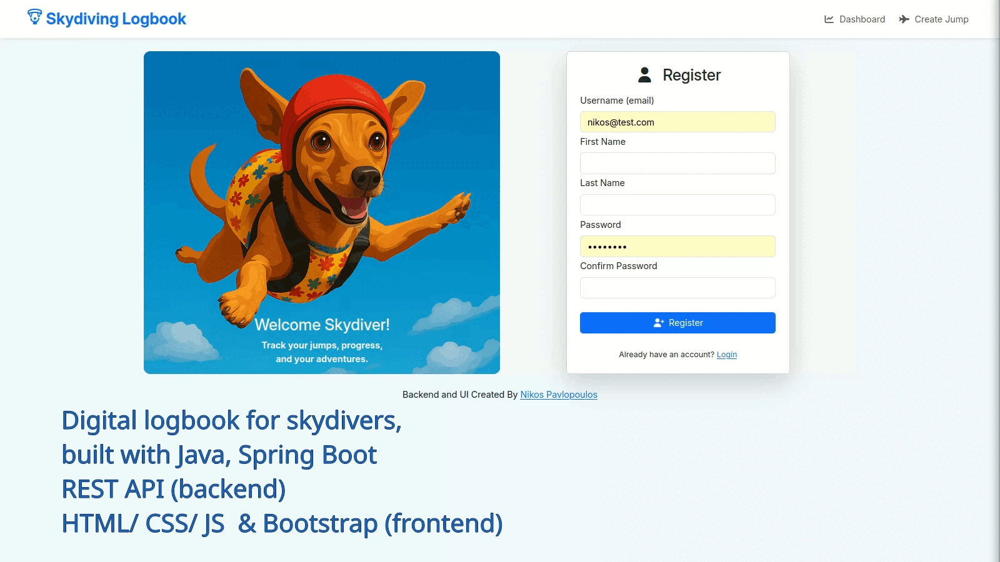
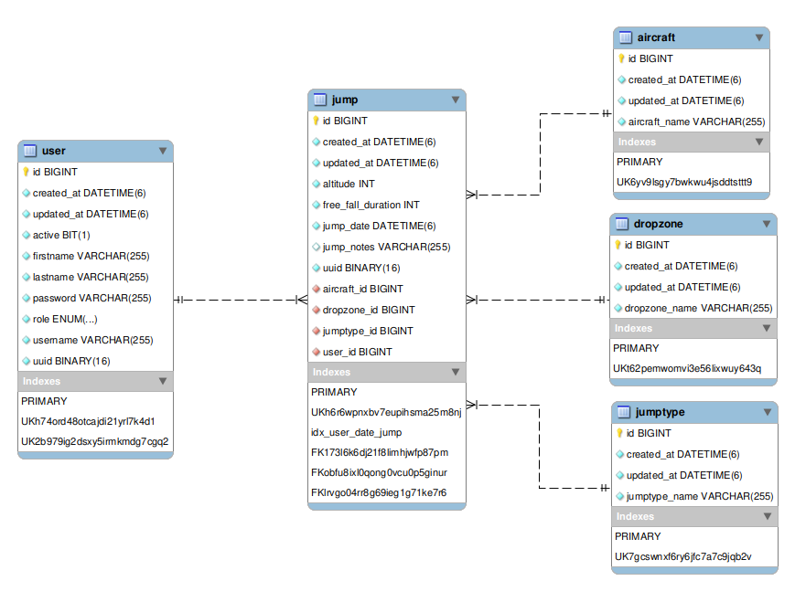
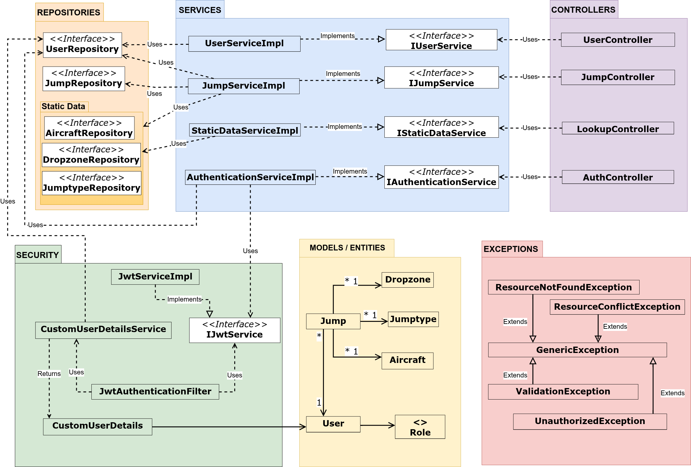

# Skydiving Logbook REST API


[](#)
[](#)
[](#)
[](#)
[](#)
[](#)
[](#) <br><br>
[](https://github.com/nikospavlopoulos/skydivinglogbook-spring-rest/actions/workflows/test-workflow.yml)
[](https://github.com/nikospavlopoulos/skydivinglogbook-spring-rest/actions/workflows/test-workflow.yml)

A **Kubernetes-ready**, event-driven RESTful API for tracking skydiving jumps, managing user accounts, and handling related static data. Built with Spring Boot, it features JWT-based security, comprehensive observability, and automated CI/CD integration.

## Video Demo

### For the [Video Demo click here](https://youtu.be/ddpZyq2-30Q?si=0WPRMsWgoW6kFFLE), or click on the gif below

[](https://youtu.be/ddpZyq2-30Q?si=0WPRMsWgoW6kFFLE)

## Table of Contents

1. [Goals & Scope](#goals--scope)
2. [TL;DR / What this repo contains](#tldr--what-this-repo-contains)
3. [Configuration & Environment](#configuration--environment)
4. [Features](#features)
5. [Tech Stack](#tech-stack)
6. [Database Schema](#database-schema)
7. [Architecture — Class Diagrams](#architecture--class-diagrams)
8. [Design Decisions & Trade-offs](#design-decisions--trade-offs)
9. [Roadmap & Future TODOs](#roadmap--future-todos)
10. [Installation & Setup](#installation--setup)
    - [Run with Docker](#-run-with-docker)
    - [Backend Quickstart](#backend-quickstart)
    - [Frontend Overview](#frontend-overview)
11. [API Endpoints](#api-endpoints)
12. [Testing & CI/CD](#testing--cicd)
13. [Project Structure](#project-structure)
14. [License](#license)

## Goals & Scope

*   **Production Readiness**: Decoupled configuration and environment isolation for seamless cloud/K8s deployment.
*   **Observability**: Integrated health monitoring and interactive documentation for developers and operators.
*   **Event-Driven Architecture**: Decoupled business logic using Spring Application Events for features like demo data generation.
*   **Maintainability**: High test coverage and strict separation of concerns between API, Service, and Persistence layers.
*   **Extensibility**: Designed to support future clients such as SPAs (React/Angular) and native mobile apps.

## TL;DR / What this repo contains

* **Backend**: Java 21 + Spring Boot (REST API). Core logic lives under `src/main/java/com/nikospavlopoulos/skydivingrest`.
* **Frontend**: Lightweight vanilla HTML/JS in `frontend-app/` used for manual demos (login, registration, dashboard).
* **DB Initialization**: SQL scripts in `src/main/resources/sql/` (H2 and MySQL) to seed static lookup data and demo records.

## Configuration & Environment

This application follows the **Twelve-Factor App** methodology. All sensitive data and environment-specific settings are decoupled from the source code.

*   **Local Setup**: A `.env_example` template is provided in the root. Copy this to `.env` and populate it with your local secrets (JWT, Database credentials).
*   **Dynamic Mapping**: Spring Boot automatically injects these variables into property placeholders (e.g., `${JWT_SECRET}`).
*   **Environment Toggles**: Features such as **CORS Allowed Origins** and **Swagger Visibility** are controlled via environment variables.

## Features

- **Observability**: Integrated **Spring Boot Actuator** providing Liveness and Readiness probes for Kubernetes orchestration.
- **Interactive Documentation**: **Swagger UI (OpenAPI 3)** integration, accessible at `/swagger-ui.html` (toggleable via `SWAGGER_ENABLED`).
- **Event-Driven Demo Logic**: Automatic generation of 5 curated sample jumps for new users when running in the `demo` profile.
- **Security**: JWT-based stateless authentication with BCrypt password hashing and role-based access control (User/Admin).
- **Jump Logging**: Comprehensive tracking with dynamic jump numbering and JPA Specification-based multi-criteria search.
- **Dashboard Stats**: Aggregate statistics (total jumps, total freefall time) and paginated/sortable jump lists.
- **Error Handling**: Standardized JSON responses with custom business exception mapping.

## Tech Stack

- **Backend**: Java 21, Spring Boot, Spring Data JPA, Hibernate, Spring Security, JWT.
- **Observability**: Spring Boot Actuator, Springdoc OpenAPI 3.
- **Build Tool**: Gradle (Dependencies: `spring-dotenv`, `jjwt`, `lombok`, `mapstruct`).
- **Database**: MySQL (Development), H2 (Testing/Demo).
- **Testing**: JUnit 5, Mockito, JaCoCo, GitHub Actions.
- **Frontend**: Vanilla HTML5, JavaScript, Bootstrap CSS.

## Database Schema

The schema ensures data consistency across users, jumps, aircraft, dropzones, and jump types.



## Architecture — Class Diagrams

Below is a compact, high-level class diagram showing the main domain classes and their relationships.



> **Detailed class diagram (methods, attributes & dependencies):** For the full diagram with class members and dependency details, see **[Detailed UML diagram](misc/uml-class-diagram.png)**.

## Design Decisions & Trade-offs

*   **JWT for Stateless Auth**: Chosen for REST-first simplicity; trades off server-side session invalidation for scalability.
*   **MapStruct for DTO Mapping**: Reduces boilerplate and keeps services clean; trades off a slightly steeper learning curve for compile-time safety.
*   **JPA Specifications**: Provides flexible multi-criteria queries without a separate query DSL; trades off code verbosity for powerful search capabilities.
*   **Standalone Frontend**: The `frontend-app/` is isolated to allow independent iteration, requiring CORS configuration for cross-origin communication.

## Roadmap & Future TODOs

1.  **Kubernetes Deployment**: Finalize Helm charts/manifests for cluster deployment.
2.  **GitOps Integration**: Automate deployments via ArgoCD.

---

## Installation & Setup

### [](#) Run with Docker

#### 1. Setup Environment
Ensure you have created a `.env` file from the `.env_example` template.

#### 2. Build and Run
```bash
docker build -t skydivinglogbook .
docker run --rm -p 8080:8080 --env-file .env --name sdlog skydivinglogbook:latest
```
*The `--env-file .env` flag is critical to pass your secrets and configuration to the container.*

### Backend Quickstart

1. **Setup .env**: Copy `.env_example` to `.env` and configure your local secrets.
2. **Build & Run**:
   ```bash
   ./gradlew bootRun
   ```
   *To enable the demo profile (automatic jump generation):*
   ```bash
   ./gradlew bootRun --args='--spring.profiles.active=demo'
   ```

### Frontend Overview
Open `frontend-app/` in VS Code and use the **Live Server** extension to serve at `http://127.0.0.1:5500`.

---

## API Endpoints

Base URL: `http://localhost:8080`.

- **Monitoring & Documentation**:
    - GET `/actuator/health`: System health status (Liveness/Readiness).
    - GET `/swagger-ui.html`: Interactive API Docs (if enabled).
- **Authentication**:
    - POST `/api/auth/login`: Authenticate and return JWT.
    - POST `/api/users`: Register a new user.
- **Jumps**:
    - GET `/api/jumps/all`: List all jumps (paginated).
    - POST `/api/jumps`: Create a new entry.
    - GET `/api/jumps/search`: Filtered search (date, type, etc.).

---

## Testing & CI/CD

- **Automated CI**: GitHub Actions executes the test suite on every push to `develop` or `main`.
- **Secrets Management**: The pipeline utilizes **GitHub Secrets and Variables** to securely inject required environment variables.
- **Coverage**: JaCoCo generates detailed reports at `build/jacocoHtml/index.html`.

### Branching Strategy
- **`main`**: Stable, production-ready code.
- **`develop`**: Primary integration branch.
- **`feat/*`**: Isolated feature branches.

---

## Project Structure
Standard Spring Boot style structure with a standalone `frontend-app` directory and `sql` initialization scripts.

## License
MIT License. See the [LICENSE](LICENSE) file for details.
